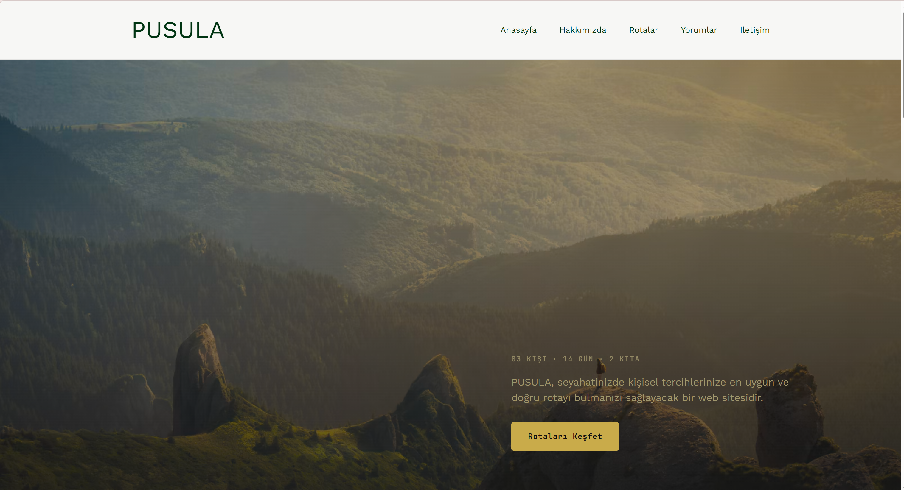
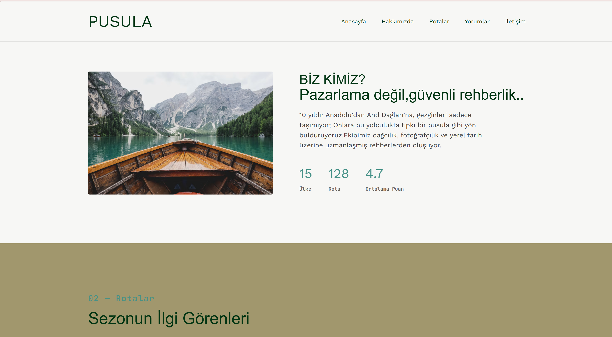
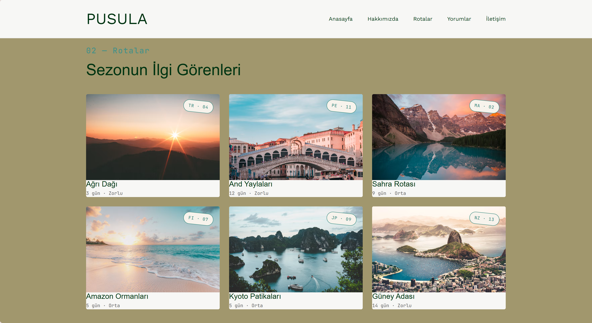
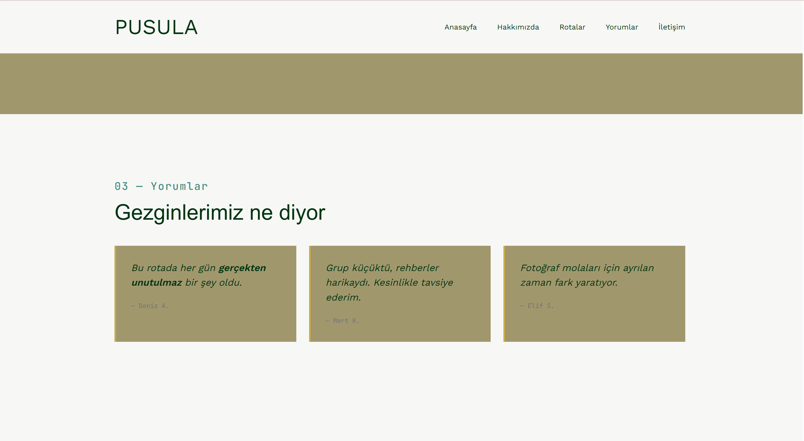
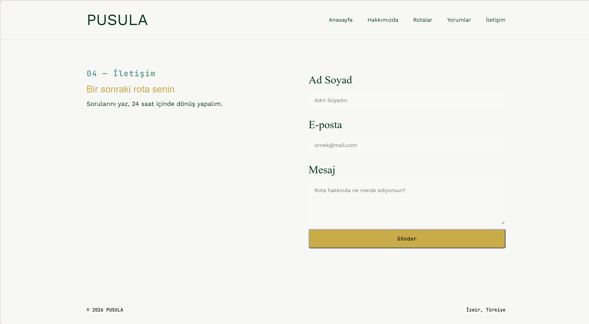

# 🧭 Pusula — Seyahat Rehberi Web Sitesi

Bu proje, temel HTML5 ve CSS3 kavramlarını uygulamak ve hata ayıklama (debugging) pratikleri yapmak amacıyla geliştirilmiş bir **seyahat rehberliği ve rota tanıtım** web sitesidir.

---

## 1. Ne Kullandık, Neden Kullandık

| Teknoloji / Kaynak | Neden Kullanıldı |
|---|---|
| **HTML5** | Sayfanın ana iskeleti ve içeriği oluşturuldu. Semantik etiketler (`header`, `nav`, `section`, `article`, `blockquote`, `footer`) tercih edildi. |
| **CSS3** | Görsel tasarım ve sayfa yerleşimi için kullanıldı. CSS değişkenleri (`:root`), Flexbox ve CSS Grid yapıları ile duyarlı (responsive) tasarım sağlandı. |
| **Google Fonts** | Gövde metinlerinde *Work Sans*, rota kodlarında *JetBrains Mono* yazı tipleri kullanıldı. |
| **Unsplash Görselleri** | Yüksek çözünürlüklü doğa ve rota fotoğrafları doğrudan harici URL bağlantılarıyla eklendi. |

---

## 2. Klasör Yapısı (Mimari)

```text
pusula_seyahat_rehberi/
├── index.html          → Sayfanın tüm içeriği ve semantik HTML yapısı
├── style.css           → Tüm görsel stiller (renk paleti, tipografi, grid/flex)
├── HATALAR.md          → Bulunan hatalar ve çözüm notları
└── README.md           → Proje dokümantasyonu (bu dosya)


---





