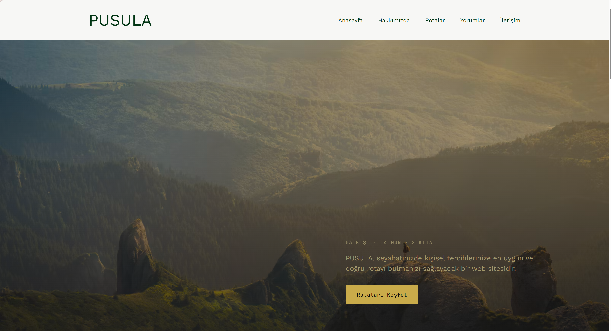
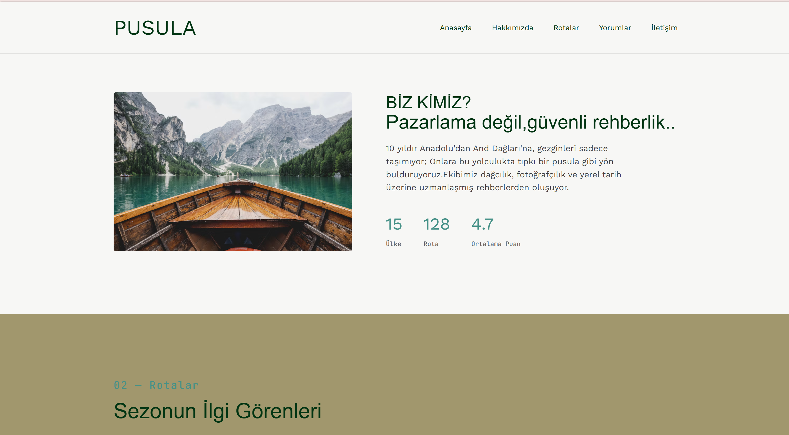
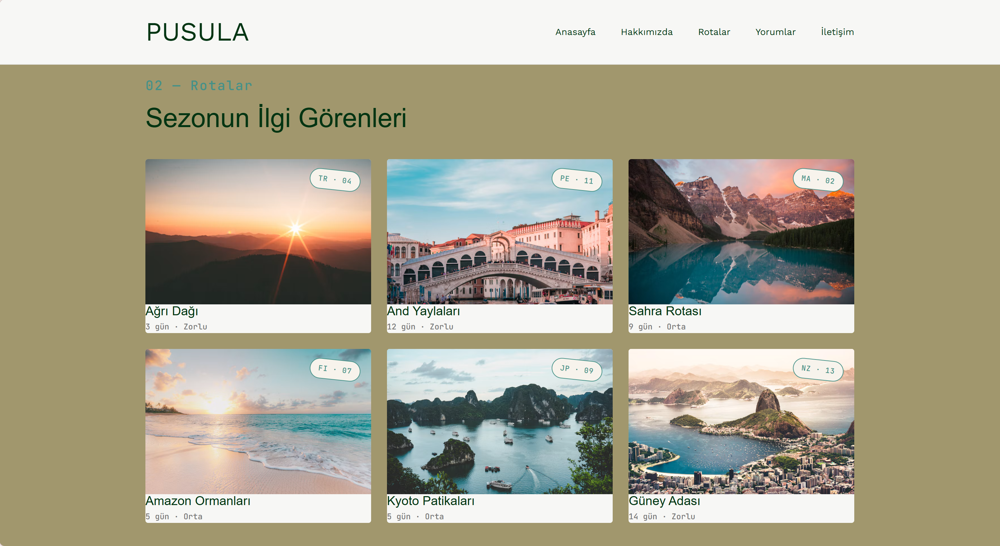
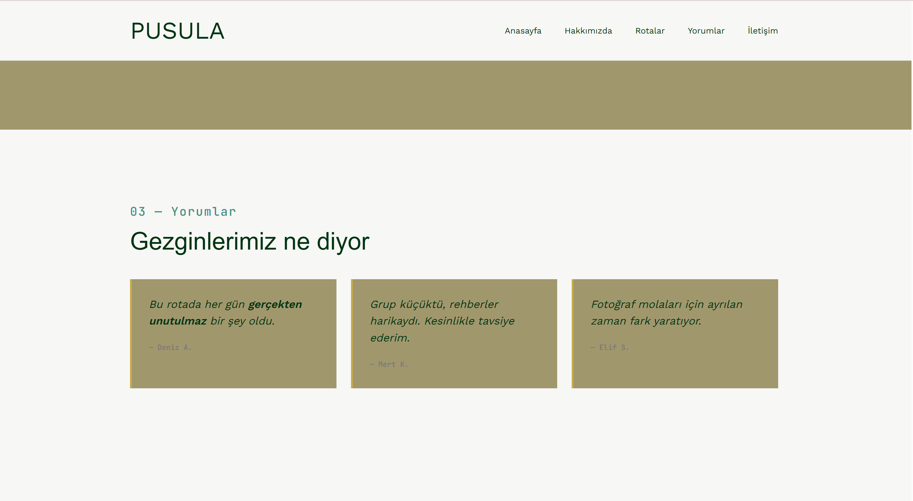
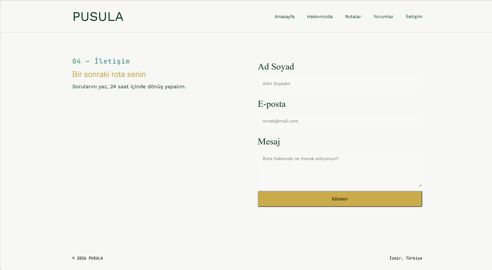

# 🧭 Pusula — Seyahat Rehberi Web Sitesi

Bu proje, temel HTML5 ve CSS3 kavramlarını uygulamak ve pekiştirmek amacıyla geliştirilmiş bir **seyahat rehberliği ve rota tanıtım** web sitesidir.

---

## 1. Ne Kullandık, Neden Kullandık

| Teknoloji / Kaynak                 | Neden Kullanıldı                                                                                                                                                                                                                  |
| ---------------------------------- | --------------------------------------------------------------------------------------------------------------------------------------------------------------------------------------------------------------------------------- |
| **HTML5**                          | Sayfanın ana iskeleti ve içeriği oluşturuldu. Arama motorları ve ekran okuyucuların sayfayı doğru yorumlayabilmesi için semantik etiketler (`header`, `nav`, `section`, `article`, `blockquote`, `footer`) tercih edildi.         |
| **CSS3**                           | Görsel tasarım ve sayfa yerleşimi için kullanıldı. Modern renk uzayları (`lab()`, `hwb()`, `oklab()`, `hsl()`), CSS değişkenleri (`:root`), Flexbox ve CSS Grid yapıları ile duyarlı (responsive) tasarım sağlandı.               |
| **Google Fonts & Sistem Fontları** | Gövde metinlerinde okunabilirliği artırmak için _Work Sans_, rota kodları ve etiketler gibi teknik detaylarda _JetBrains Mono_, ana başlıklarda ise yüksek okunurluk sunan _Arial / Helvetica_ yazı tipleri bir arada kullanıldı. |
| **Unsplash Görselleri**            | Projeye ek görsel dosyası yükleyip depoyu büyütmemek ve yüksek çözünürlüklü doğa/rota fotoğrafları sunmak için görseller doğrudan harici URL bağlantılarıyla eklendi.                                                             |

Harici bir CSS kütüphanesi veya JavaScript (Bootstrap, Tailwind vb.) **kullanılmadı** — tüm yerleşim ve etkileşimler saf HTML ve CSS ile kurgulandı.

---

## 2. Klasör Yapısı (Mimari)

```text
pusula_seyahat_rehberi/
├── index.html          → Sayfanın tüm içeriği ve semantik HTML yapısı
├── style.css           → Tüm görsel stiller (renk paleti, tipografi, grid/flex yerleşimi)
└── README.md           → Proje dokümantasyonu (bu dosya)

## 3. Kurulum ve Çalıştırma

Projeyi bilgisayarınızda görüntülemek için herhangi bir ek kurulum veya sunucu gerekmez:

1. Bu depoyu (repository) bilgisayarınıza indirin veya klonlayın.
2. Proje klasörünün içindeki `index.html` dosyasına çift tıklayarak herhangi bir web tarayıcısında (Chrome, Edge, Safari vb.) açın.

## Geliştirici

* **[HELİN TÜRK]** - *HTML & CSS Öğrencisi*
```






